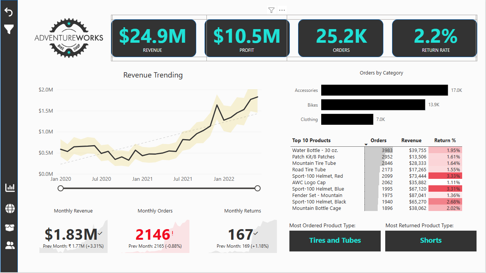
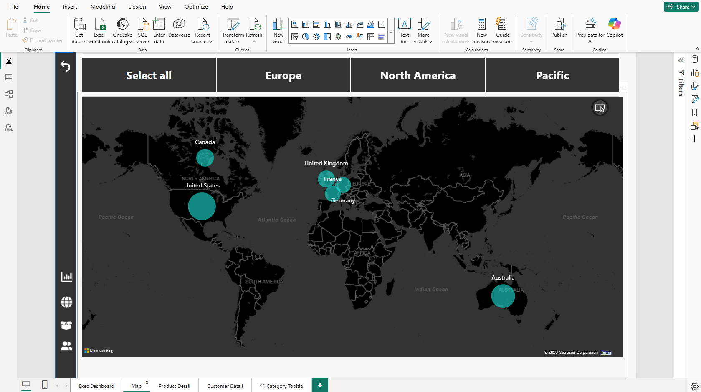
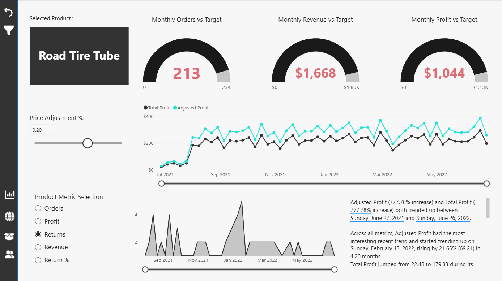
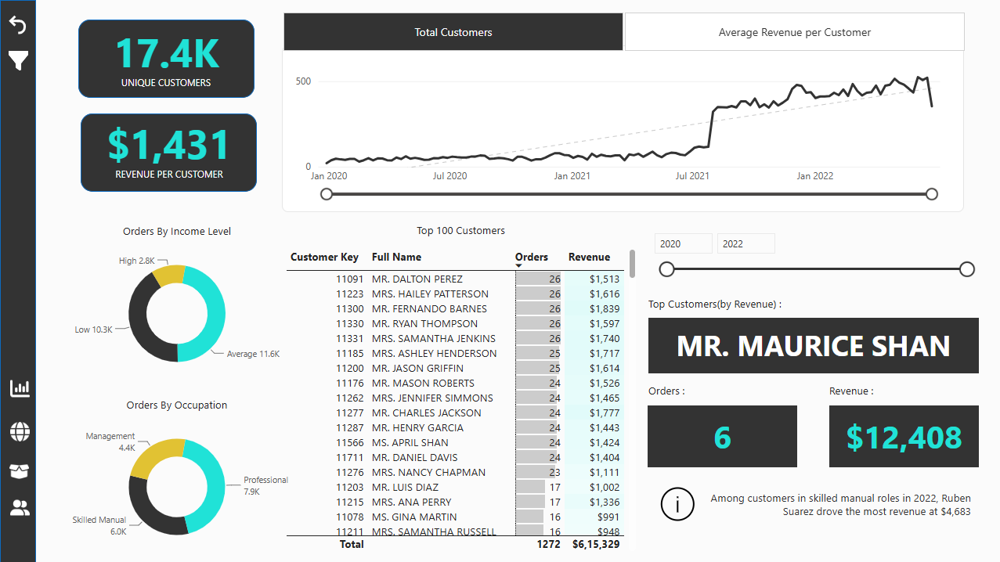

# AdventureWorks Business Intelligence Dashboard

<p align="center">
  <strong>Interactive sales, product, customer, returns, and regional analysis using Microsoft Power BI</strong>
</p>

<p align="center">
  
</p>

<p align="center">
  
  
  
  
</p>

## Project Overview

The **AdventureWorks Business Intelligence Dashboard** is a Power BI Desktop project for exploring business performance across sales, revenue, profit, returns, customers, products, and territories. It brings multiple CSV datasets together in a relational model and presents the data through an interactive report.

The project work covers the business intelligence workflow: preparing source data with Power Query, creating relationships between tables, developing DAX calculations, designing report visuals, and checking report behavior and results.

**Project author:** Mukesh Yadav  
**Primary tool:** Microsoft Power BI Desktop  
**Report pages:** 4 *(as provided by the project author)*  
**Audience:** Recruiters, hiring teams, and portfolio reviewers

> **Data disclaimer:** This project uses AdventureWorks sample data for analytical practice and demonstration. The results should not be interpreted as verified performance figures for a real operating company.

## Live Power BI Report

Explore the interactive AdventureWorks dashboard in Power BI:

[**Open the Live Power BI Dashboard**](https://app.powerbi.com/view?r=eyJrIjoiYWI5NmExYmMtNTVlYi00NjViLTliOGUtM2I1NGRhYWIyZmVjIiwidCI6IjY4ZDMyNDJhLTk0MjYtNDViYS1hZDRmLTJhMDZiOWIyMDdlOSJ9&embedImagePlaceholder=true)

## Project Goals

- Analyze sales and revenue trends over time.
- Evaluate profit and product performance.
- Explore returns and product categories.
- Understand customer and territory performance.
- Present key measures in a clear, interactive report.
- Practice end-to-end BI development, from data preparation to report validation.

## Technology Stack

| Tool / technology | How it is used |
|---|---|
| Microsoft Power BI Desktop | Data modeling, calculations, and report development |
| Power Query | Importing, cleaning, and transforming source data |
| DAX | Measures and calculated columns for business analysis |
| CSV files | Source datasets |
| Relational data modeling | Connecting transaction data to lookup tables |

## Dashboard Preview

The report contains four main pages. The screenshots below should be saved in the repository under `screenshots/` using the filenames shown. The image links are ready for GitHub once you add those screenshot files.

### 1. Executive Dashboard

The overview page presents headline KPIs for revenue, profit, orders, and return rate, alongside a revenue trend, orders by category, a top-products table, monthly revenue/orders/returns cards, and most-ordered/most-returned product types.



### 2. Map

The map page visualizes geographic performance and includes region selection for Europe, North America, and Pacific. The screenshot shows location bubbles for markets including Canada, the United States, the United Kingdom, France, Germany, and Australia.



### 3. Product Detail

The product page supports analysis of a selected product, monthly orders/revenue/profit versus targets, a price-adjustment control, a product metric selector, and time-based trends.



### 4. Customer Detail

The customer page includes unique-customer and revenue-per-customer KPIs, customer trends, order breakdowns by income level and occupation, a customer table, year filtering, and top-customer details.



**Screenshot setup:** Create a folder named `screenshots` in the repository and save your four actual report screenshots with the exact filenames above. The README references the screenshots, but the image files must also be committed for them to appear on GitHub.

## Business Areas and KPIs

The report screenshots visibly include these KPI cards and analysis elements:

| Area | Visible report elements |
|---|---|
| Executive performance | Revenue, Profit, Orders, Return Rate |
| Time trends | Revenue trending, monthly revenue, monthly orders, monthly returns |
| Product performance | Orders by category, top 10 products, product-specific orders/revenue/profit versus targets |
| Returns | Return-rate column in the product table, monthly returns, most-returned product type |
| Geographic performance | Map with selectable Europe, North America, and Pacific regions |
| Customer analytics | Unique customers, revenue per customer, orders by income level and occupation, top customers by revenue |

The Executive Dashboard screenshot visibly displays **$24.9M revenue**, **$10.5M profit**, **25.2K orders**, and a **2.2% return rate**. These are values shown in the supplied screenshot; they may change with report filters or data refresh. Other figures should be read from the report in the relevant filter context. No additional findings are inferred here.

## Data Sources

The supplied project archive contains the following CSV datasets:

| Dataset | Purpose |
|---|---|
| `AdventureWorks Sales Data 2020.csv` | Sales transactions for 2020 |
| `AdventureWorks Sales Data 2021.csv` | Sales transactions for 2021 |
| `AdventureWorks Sales Data 2022.csv` | Sales transactions for 2022 |
| `AdventureWorks Calendar Lookup.csv` | Calendar and date attributes |
| `AdventureWorks Customer Lookup.csv` | Customer attributes |
| `AdventureWorks Product Lookup.csv` | Product attributes |
| `AdventureWorks Product Categories Lookup.csv` | Product category reference data |
| `AdventureWorks Product Subcategories Lookup.csv` | Product subcategory reference data |
| `AdventureWorks Returns Data.csv` | Product return records |
| `AdventureWorks Territory Lookup.csv` | Territory/region reference data |
| `Product Category Sales (Unpivot Demo).csv` | Supporting transformation/demo dataset |

## Repository Structure

The following structure reflects the supplied ZIP archive. The archive contains repeated nested folder names; those are shown here so that the README paths match the provided files.

```text
AdventureWorks/
├── AdventureWorks Project.pbix
├── AdventureWorks Images/
│   └── AdventureWorks Images/
│       ├── AdventureWorks_Logo.png
│       ├── Customer_Icon.png
│       ├── Customer_Icon_Blue.png
│       ├── Dashboard_Icon.png
│       ├── Dashboard_Icon_Blue.png
│       ├── Filter_Icon.png
│       ├── Filter_Icon_Blue.png
│       ├── Map_Icon.png
│       ├── Map_Icon_Blue.png
│       ├── Product_Icon.png
│       └── Product_Icon_Blue.png
├── AdventureWorks PBIX Files/
│   └── AdventureWorks PBIX Files/
│       ├── AdventureWorks Report_FINAL.pbix
│       └── WIP Reports/
│           ├── AdventureWorks Report_AI Complete.pbix
│           ├── AdventureWorks Report_Data Model Complete.pbix
│           ├── AdventureWorks Report_DAX Complete.pbix
│           ├── AdventureWorks Report_Power Query Complete.pbix
│           └── AdventureWorks Report_Visualization Complete.pbix
└── AdventureWorks Raw Data/
    ├── AdventureWorks Raw Data/
    │   ├── AdventureWorks Calendar Lookup.csv
    │   ├── AdventureWorks Customer Lookup.csv
    │   ├── AdventureWorks Product Categories Lookup.csv
    │   ├── AdventureWorks Product Lookup.csv
    │   ├── AdventureWorks Product Subcategories Lookup.csv
    │   ├── AdventureWorks Returns Data.csv
    │   ├── AdventureWorks Territory Lookup.csv
    │   └── Product Category Sales (Unpivot Demo).csv
    └── Sales Data/
        ├── AdventureWorks Sales Data 2020.csv
        ├── AdventureWorks Sales Data 2021.csv
        └── AdventureWorks Sales Data 2022.csv
```

The archive also contains macOS metadata files (`__MACOSX`, `.DS_Store`, and `._*`) that are not required to use the project. Consider excluding these from the public repository.

## How to Open the Project

1. Install [Microsoft Power BI Desktop](https://powerbi.microsoft.com/desktop/).
2. Clone or download this GitHub repository.
3. Open `AdventureWorks Project.pbix` in Power BI Desktop. Alternatively, open `AdventureWorks PBIX Files/AdventureWorks PBIX Files/AdventureWorks Report_FINAL.pbix` to inspect the separately supplied final report.
4. If Power BI reports missing data sources, update the source paths to the CSV files in the `AdventureWorks Raw Data` folders.
5. Select **Home → Refresh** after confirming the data-source paths.
6. Review the report pages, slicers, visuals, and model view.

**Path note:** The supplied archive has nested folders with repeated names. If you reorganize the files, update the Power Query source paths accordingly.

## Development Workflow

1. **Data preparation:** Import the CSV files and inspect data types, missing values, and column quality in Power Query.
2. **Data transformation:** Clean and shape fields as needed for analysis.
3. **Data modeling:** Define relationships between sales/returns data and relevant lookup tables.
4. **DAX calculations:** Build measures and calculated columns required by the report.
5. **Visualization and interaction:** Build KPI cards, trend charts, tables, a geographic map, region selectors, date-range controls, product metric selection, and customer filters.
6. **Validation:** Check totals, filter interactions, relationships, and calculation behavior against the available source data.

This describes the workflow reported for the project; the exact transformations, relationship cardinalities, and DAX expressions should be documented from the current Power BI model.

## Skills Demonstrated

- Power BI Desktop report development
- Power Query data cleaning and transformation
- Relational data modeling and table relationships
- DAX measures and calculated columns
- KPI and business-report design
- Data validation and testing
- Communicating business performance through visual analytics

## Results and Insights

Use the report to explore trends and compare performance across time, products, customers, returns, and territories. **Specific findings are not listed here** because no verified numerical insights were supplied. Add a few concise findings only after checking the current report and confirming the figures.

Suggested format for adding verified insights:

- **Finding 1:** `[Metric or trend]` changed from `[value/period]` to `[value/period]`.
- **Finding 2:** `[Product/category/territory]` had the highest `[verified metric]` during `[period]`.
- **Finding 3:** `[Verified return/customer pattern]` may warrant further investigation.

Replace every placeholder with a result you have personally verified; do not publish these examples as findings.

## Limitations and Notes

- This repository contains Power BI Desktop `.pbix` files and supporting data; a published Power BI Service dashboard link was not present in the supplied archive.
- Data refresh may require updating local file paths.
- The project archive contains multiple intermediate `.pbix` versions. Use the version that best represents the final report and label it clearly.
- Sample data and analysis are for demonstration and learning, not verified real-company reporting.
- The README describes the project bundle and the work you reported. Review the final report before claiming any particular measure, transformation, or insight.

## Author

**Mukesh Yadav**

- GitHub: [@MukeshYadav27](https://github.com/MukeshYadav27)
- Project repository: [AdventureWoks-Project](https://github.com/MukeshYadav27/AdventureWoks-Project)

---

*This README documents the supplied AdventureWorks Power BI project. Update the screenshots, actual report page names, and verified insights to keep the portfolio accurate and representative of your own work.*
